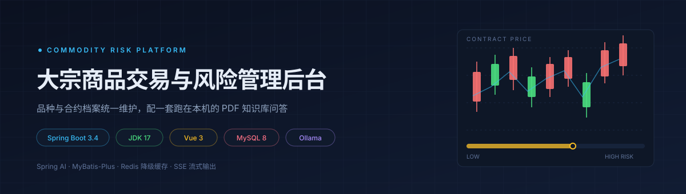

<div align="center">
  
</div>

<p align="center">
  <a href="README.md">中文</a> · <b>English</b>
</p>

<p align="center">
  
  
  
  
  
  
</p>

<h1 align="center">🛢️ SmartHedge Risk Hub</h1>

A commodity trading and risk management back office. Spring Boot 3 + MyBatis-Plus on the server, a Vue 3 single-page app under `static/` on the client (no build step, runtime files loaded from `vendor/`), plus a PDF knowledge base Q&A module backed by a local Ollama instance.

The system maintains reference data: trading varieties, exchanges, futures contracts, spot products, supply categories, origins, operators and suppliers. It does not do order matching or settlement.

## Modules

| Module | Description |
| --- | --- |
| Auth | Session-based login, route guard calls `/api/user/current` on startup |
| Dashboard | Counts of varieties, categories, operators, spot products, suppliers, contracts |
| Trading varieties | Paged list, joined with exchange and industry |
| Supply categories | List and keyword search |
| Origins | Paged dictionary, used as a dropdown source |
| Operators | Full list |
| Spot products | Create and paged list |
| Suppliers | CRUD, keeps the supplier-category relation table in sync |
| Futures contracts | CRUD, joined with trading variety |
| Exchanges | CRUD and paging on the server, cached in Redis, no dedicated page yet |
| Knowledge Q&A | Upload PDF/MD/TXT, split and embed, stream answers with citations |

## Stack

| Layer | Choice |
| --- | --- |
| Runtime | JDK 17 |
| Framework | Spring Boot 3.4.3 |
| Persistence | MyBatis-Plus 3.5.10.1, Druid 1.2.23 |
| Database | MySQL 8 |
| Cache | Redis via `StringRedisTemplate`, JSON values |
| Frontend | Vue 3 + Element Plus, plain `<script>` tags |
| AI | Spring AI 1.0.0-M6 + Ollama (`qwen2.5:7b`, `bge-m3`) |

## Run

```bash
# 1. database
mysql -uroot -p --default-character-set=utf8mb4 smarthedge_risk_hub < sql/sys_user.sql

# 2. optional AI models
ollama pull qwen2.5:7b
ollama pull bge-m3

# 3. start
./mvnw spring-boot:run
```

Open http://localhost:8086 and sign in with `admin / 123456`.

Database credentials come from `src/main/resources/jdbc.properties`, which reads `MYSQL_USERNAME` and `MYSQL_PASSWORD` with local defaults.

## Knowledge Q&A

`POST /api/ai/ask/stream` returns `text/event-stream` with three event types: `sources` (matched chunks with file name, index and excerpt), `token` (incremental output), `done` (elapsed milliseconds).

Citations are sent before generation starts, so the page is not blank while the model works. All SSE payloads go through Jackson, because raw string concatenation breaks the frame whenever the model emits a newline. The emitter disposes the upstream subscription on timeout or error so the model stops generating after the client disconnects. The system prompt restricts answers to retrieved context and forbids inventing margin ratios, fees or price limits.

On first start the four PDFs bundled in `classpath:knowledge/` are extracted to `./knowledge`, parsed page by page, split with `TokenTextSplitter`, embedded with `bge-m3` and persisted to `data/vectorstore.json`. A fingerprint file decides whether the index can be reused.

## Redis

Exchange data is cached as JSON strings. When Redis is unreachable the cache layer opens a 60 second circuit and reads straight from MySQL, logging one warning instead of blocking every request on a connection timeout.

## API

40 endpoints. Full mapping between page, endpoint and table is in [docs/功能-接口-数据表对照.md](docs/功能-接口-数据表对照.md) (Chinese).

## Known limitations

- Passwords are stored in plain text; switch to BCrypt before any real deployment.
- Business endpoints have no server-side auth; protection lives in the frontend route guard only.
- Paging is done in memory (`subList` after a full query). Use `IPage` for large tables.
- Editing a supplier does not preload its category relations, so saving clears them.
- Registration is open, no invite code or approval.
- Chat memory is in-process and lost on restart.
- Splitter parameters are hard-coded.
- The exchange module has endpoints but no page.

## Feedback

- Bugs and suggestions: open an [issue](../../issues)
- Implementation details or custom work: **QQ 250264668**
- If the project helps, a star is the best support

## 💗 Support

No ads, no paywall, MIT all the way. If this saved you from wiring a back office from scratch,
you can buy me a coffee. **Entirely optional, nothing changes if you don't.**

<table align="center">
  <tr>
    <td align="center" width="240"><br><b>Alipay</b></td>
    <td align="center" width="240"><br><b>WeChat</b></td>
  </tr>
</table>

## 🛠️ Custom development

If you want this in your own setting:

- Retarget the reference data modules to another industry, with dictionaries, fields and approval flows matching your tables
- Integrate with an existing ERP, trading or risk system
- Swap the knowledge base for internal policies or compliance documents and run it fully offline
- Anything else you have in mind

**Contact: QQ `250264668`** (mention what you need, e.g. "custom back office").

> Custom work is paid and quoted per scope. The open source version stays exactly as it is.

## License

[MIT](LICENSE)
